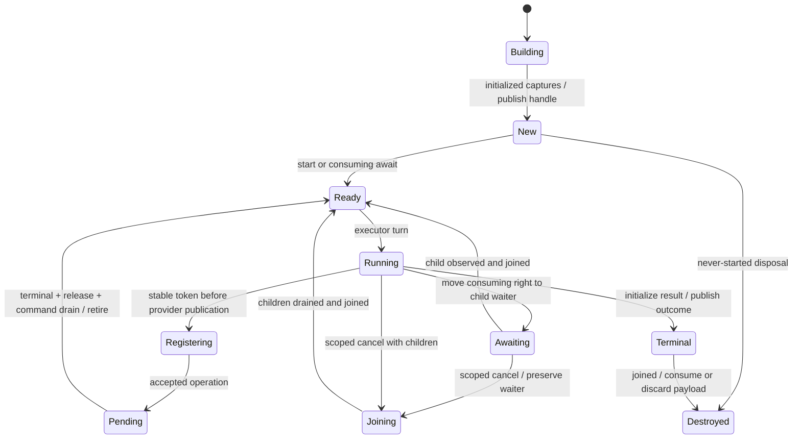

# Proposed native async contract

Current successor: [A2 native tasks](../language/async.md) and the explicitly authorized [L1 Linux provider](../platform/linux-uring-timers.md). The R3 proposal, Q01–Q35 text and historical source-inspection status below are preserved.

**ASTRA-ASYNC-CONTRACT-1 R3, 2026-10-03. Proposed / user review required.**
This is the normative recommendation for Q01–Q06, not delivered language behavior.
The R3 review records the corrections
and decisions awaiting approval; the [Linux profile](../platform/linux-async-profile.md)
supplies one platform realization. Only the native-kernel-first platform direction is already
user-approved. All 35 roadmap questions remain OPEN. No tokens, production types,
ABI, dependencies or executor are introduced by this design/model commit.

## Recommendation and current authorities

Recommend `async` declarations and `await`, deferred body start, a unique Task
with one consuming observation, explicit structured join obligations, stable
allocated frames, narrow parent-local suspension loans, a three-way completion,
and compiler-generated continuations before general callable values. The first
real provider should be a one-shot native Linux timer with cancellation. The
founding Bible §§24–25 requires one function/environment/lifetime contract and
native state-machine/frame/executor lowering, including later embedded and
Dreamcast realizations. It does not select these particular answers.

The following audit is against commit
`5039f554f511e0580ec9de8f8ed46e7bc273c268`, not a future compiler:

| Authority inspected | Confirmed input | Limit / required addition |
| --- | --- | --- |
| [Type and callable identities](../../bootstrap/semantic/types.vala), `CallableKind`, `SemanticType`, `SliceType` | Exact functions/methods/init/deinit/accessors; slice permissions distinguish mutable elements from deep text views | No task or callable-value type. Add logical Task/completion and continuation descriptors; do not reuse ClassType or a slice pair as Task. |
| [Parameter/result contracts](../../bootstrap/semantic/pointer-parameter-contract.vala), `PointerParameterContract`, `ResultOwnershipContract` | BORROWED_NOESCAPE, OWNED_TRANSFER and STATIC_TEXT | Synchronous noescape does not admit deferred capture. Add a suspension-loan obligation independent of a physical pointer. |
| [Call lowering](../../bootstrap/cfg/cfg-builder.vala), `lower_call`, `lower_arguments`, `CfgOwnedCallTransferCommit` | Receiver then written arguments; snapshots before later effects; named owner transfers commit together before call | Async creation must preserve this order while publishing a new frame. No body invocation at capture time. |
| [Owner facts](../../bootstrap/semantic/ownership-state.vala), `OwnershipState`; [CFG flow](../../bootstrap/cfg/ownership-flow.vala), `OwnershipFlow.analyze` | OWNED/MOVED/RELEASED possibility sets, normal cleanup, invalid overlap rejection | A live task adds scheduler/registration/child obligations; pointer nullness cannot represent them. |
| [Borrow provenance](../../bootstrap/semantic/lexical-region.vala), `LexicalRegion.outlives`, `BorrowProvenance`; [buffer flow](../../bootstrap/ssa/ssa-buffer-flow.vala) and [SSA verifier](../../bootstrap/ssa/ssa-verifier.vala) | Lexical backing and owner invalidation intervals | Add declaration-level suspension loans, sealing and resume-edge checks. An observed caller or a currently nonnull field is insufficient. |
| [Object results](../../bootstrap/semantic/semantic-object-results.vala), `ResultObjectStorageSymbol`; [object contract](../language/object-results.md) | Fresh Class results use caller-provided storage; only ancestor-owned inputs may be forwarded | A callee-local Class owner cannot escape. Class task input/result is excluded initially; no generic Class allocation is presumed. |
| [Materialization](../../bootstrap/core/generic-monomorphizer.vala), `CoreGenericMonomorphizer`; [generic arrays](../language/generic-owned-arrays.md) | Canonical specialization before concrete CFG; owned T[] requires signature-derived element premises | Task result constructors need explicit substitution rules. Generic owner locals and general owning aggregates remain deferred. |
| [Native buffer plans](../../bootstrap/nabi/native-buffer-values.vala), `NativeBufferValuePlan`; [allocation lowering](../../bootstrap/backend/llvm/llvm-buffer-allocation.vala) | Unique base/length owner transport; initialized allocation and fatal null/overflow behavior | A result slot also needs discriminant, publication and consumption authority. Frame allocation is a new bounded facility, not recoverable `new` by implication. |
| [Entry plans](../../bootstrap/nabi/native-entry-builder.vala), [driver](../../bootstrap/main.vala) | Explicit host source/VAPI/object/library selection and synchronous entry | Keep `int main()` synchronous. Explicit runtime selection and `executor.run(move root)` adapt it; no invisible runtime autolinking. |

The [capability matrix](../language/capabilities.md) remains the delivered-feature
index. None of its owning-object, generic-owner-local, error or callback limits
is lifted here. [Fatal allocation actions](../language/allocation-failure.md)
still trap without caller unwinding. This audit required source inspection only;
no new compiler check, compiler rebuild or historical suite replay was needed.

## Q01: source, creation and observation

`async int f(...)` declares the **body's success payload**, whereas calling it
produces a logical `owned Task<int>`. `async owned int[] f(...)` produces a
Task whose success case transfers one existing buffer owner. This is a dedicated
semantic constructor, not implementation of generic classes. Initially admit
void, existing scalar/copyable record payloads and concrete owned runtime arrays
with already supported elements. No borrowed result, Class result, owning record
or arbitrary generic Task is promised. A copied record is an independent value;
a buffer result is a responsibility; a view is neither.

Creation evaluates receiver and arguments once, left to right, in the caller.
All existing capture-before-effect and same-owner overlap restrictions apply.
Reserve stable storage, install initialized captures, commit named `move`s as one
checked ownership step, then publish the handle. The body has not run. An invalid
later argument rejects statically; a fatal argument/allocation failure terminates
without a handle or an unwinding promise. Internal partial-initialization cleanup
may dispose only established fields on a normal construction-error path; there is
no source recoverable frame-allocation API in this first proposal.

Eager execution would avoid an explicit start and allow prefix work immediately,
but makes construction reentrant and couples capture with user effects. Deferred
execution permits application-controlled scheduling and never-started disposal;
it still requires capture lifetime **from the call**, not from the first await.
Recommend deferred start. Before enrollment the cold handle owns the stable
frame, captures and its allocator retention obligation. Hosted creation uses the
compiler-selected native allocator under the existing fatal OOM policy, without
selecting an executor. This allocator has process lifetime; a later regional
allocator would need explicit retained authority in the handle. Ordinary argument
evaluation creates `application()` before entering `executor.run(application())`.
The caller's temporary owns it until run takes ownership at function entry.

`start(task)` borrows a live unique New handle. It returns a bounded synchronous
Success (enrolled and queued) or Error(EnrollmentCapacity/ExecutorClosing).
On failure the handle remains New, owns all captures and allocator authority,
and can be retried or synchronously disposed. No body runs and no move commits.
On first successful enrollment, association with the selected explicit executor
becomes immutable; scope retention takes responsibility for the allocation while
the handle keeps its observation/cleanup right. Ready-queue pressure after
admission uses the dirty latch and does not undo enrollment.

`await move task` consumes that right into a waiter and enrolls New work if
needed. Inline `await f(...)` consumes its fresh temporary directly. On failed
admission the waiter owns and disposes the still-cold frame synchronously, then
yields Error(code); there is no started-child obligation. This differs explicitly
from non-consuming start failure. Awaiting an already terminal task need not
suspend; start never executes inline user code.

The cold handle is movable within its lexical creator scope; after enrollment
the handle is movable between locals only in its associated executor scope; the
frame address does not move. No copy, aggregate/task field, returning a task,
detaching, migration or cross-thread transport is initially admitted. Rebinding
may dispose only a New or joined terminal destination; overwriting a live started
task is rejected. Any scalar result follows the same single-observer rule as an
owned result. Copy its scalar/record **after** consuming completion if multiple
readers are wanted. Multi-await/shared Tasks require a separate lifetime/result
policy and remain deferred.

Ignored async call expressions reject: explicitly bind or directly await them.
Dropping a never-started task destroys captures once without executing its body.
Dropping a joined terminal task discards any unconsumed success/error payload
once. A second consuming await, use after move, or consuming an uninitialized
slot rejects. Do not copy an owner because its Task has several interested callers.

`async`/`await` makes completion observation visible separately from a future
cooperative yield/stream operation. `async`/Vala-style `yield f(...)` is an equally
readable alternative, but `yield;` would need an additional resumption authority.
Recommend `await`; no spelling is reserved. For comparison, the
[Vala tutorial's Asynchronous Methods](https://wiki.gnome.org/Projects/Vala/Tutorial#Asynchronous_Methods)
describes `async`, `yield`, begin/end and callbacks; only its readable suspension
surface is relevant. Its ABI does not determine Astra semantics. Microsoft's
[C# asynchronous model](https://learn.microsoft.com/en-us/dotnet/csharp/asynchronous-programming/async-scenarios#explore-the-asynchronous-programming-model)
shows `async`/`await` and state-machine lowering. These are the only two language
precedents inspected (2026-10-03); neither is authority for unique ownership,
deferred creation, native provider lifetimes or a thread pool here.

## Q02: lifecycle and explicit joining

Represent execution, cancellation request, registration quiescence and result
observation separately. The legal execution path is:



Cancellation is a monotone request flag and a checkpoint, not an immediate jump
to Terminal. New tasks can be canceled and disposed without entering the body.
Ready/Running tasks check before another suspension and before terminal
publication. Registration prepared but not published can be revoked locally;
if shared-ring submission might have accepted it, retain it and obtain terminal
evidence. Pending tasks issue at most one cancel command per operation and drain
the target terminal event, payload release and any outstanding command result.
A cancel acknowledgment alone does not supply any of these other proofs.

If cancellation is recorded before body result publication, the drain/cleanup
continuation publishes Cancelled after quiescence and disposes would-be success
state. If Success/Error was already published, cancellation cannot replace it
or steal its payload. Completing a kernel operation does not immediately publish
a source task result: a ready continuation can still observe a cancellation
request. Error and cancellation ordering is governed by that same checkpoint.

Recommend a checked join obligation for every started task. Ordinary scope exit
with such a handle rejects unless all normal paths consume/join it. Never hide a
blocking cancel, nested pump, detach, leak or asynchronous destructor inside a
drop. `await cancel_and_join(move task)` requests cancellation, consumes the
result right, waits for drain, discards any pre-existing result and returns void.
It is an explicit suspending operation. A direct await already owns this join
obligation until completion. Once joined, release is synchronous.

The parent scope records children independently of observation rights. On normal
source paths the programmer awaits them before returning. On generated parent
cancellation paths the state machine cancels/drains children before destroying
parent backing or returning Cancelled. This is explicit async cancellation
lowering, not user `deinit` suspension. No child outlives that scope; a never
started child is disposed. Destruction order follows child drain, then existing
reverse lexical cleanup for still-live parent captures/locals. Siblings may drain
in completion order; their independent ownership does not imply cleanup timing
order between tasks. A parent terminal result is withheld while children remain.
A parent-only request
propagates to its live nonterminal descendants even when the parent is suspended
awaiting one of them. It does not close the executor or cancel unrelated tasks.
A terminal child's published outcome remains immutable. The bounded model applies
this request atomically; a native staged walk must record and fairly service the
remaining fan-out responsibility before cleanup.

A consuming await moves the right at entry, before child completion: the source
handle becomes unusable and one waiter attached to the parent owns the right and
join obligation. While suspended, the parent frame and child backing stay live.
Child operation completion, child source terminal publication, consuming result
transfer/discard and child-frame join are separate steps. Cancellation switches
the parent to its generated Joining continuation; it preserves the pending right,
requests child cancellation, waits for observed drain, then discards even an
already published success/error result. Ordinary await transfers the result once.
Only after child-frame join can the parent resume or complete cancellation.

The model's `await_child` moves the handle right into `waiter` and sets the parent
to Awaiting; `cancel` changes Awaiting to Joining without losing that waiter.
Terminal-only `observe` completes the earlier right transfer; it cannot begin a
pending await by itself. `destroy` finishes the child's join and wakes the parent.
A rejected cold admission leaves model state intact; source consuming-admission
failure refines that rejection followed by `destroy` of the waiter-owned New
child and Error delivery. This bounded mapping is not a general source interpreter.

Executor shutdown refuses new enrollment, cancels all enrolled tasks, continues
draining/pumping, retires provider tokens, joins/discards results and releases
frames, then provider mappings and the executor's allocator. A manual host must
drive `begin_shutdown`/`pump` until `shutdown_complete`; it cannot just drop the
executor. The hosted `run` is the explicit place that drives this protocol. An
operation without eventual release prevents normal shutdown completion. A timeout
may report incomplete shutdown, but cannot license early free. Fatal process
termination remains a separate non-unwinding exit.

User cleanup can call synchronous code and have effects under existing contracts.
It cannot suspend or report a recoverable destructor failure in this subset. A
trap/exit inside cleanup is fatal; remaining cleanup is not promised. Cancellation
is a normal lifecycle path with an initialization bitmap; it is not blanket
exception unwinding or signal translation.

## Q03: suspension loans and stable identity

A suspension loan starts at capture and ends only when the child/provider can
no longer use it. Initially admit it only for a directly awaited child borrowing
parent-local backing whose aliases cannot escape the suspended parent. The parent
is paused; other cooperative tasks must have no alias capable of replacing,
releasing or accessing that loaned backing. This is an additional local loan
restriction, not retroactive exclusivity for ordinary aliasable mutable slices.
It must be proven at declaration and call sites; runtime values and single-thread
execution cannot replace this proof. The first scheduled siblings take owned
inputs or copy values; borrowed task handles cannot be stored or separately started.

| Input or view | Call / deferred interval | Across suspension | Completed / rejected escapes | Proof authority |
| --- | --- | --- | --- | --- |
| Scalar / copyable record value | Snapshot at call | Admit independent frame slot | Result copied only after observation | Existing COPY_VALUE plus frame initialization |
| Borrowed scalar/record typed pointer | Parent-local provenance required at capture | Only direct awaited child loan; pointee stable, alias confined | No task return, stored/scheduled borrowed child or borrowed result | New suspension-loan verifier; existing pointer checks still apply |
| Mutable numeric/record slice | Base and extent captured; owner loan starts immediately | Parent-local fixed/owned buffer, no escaping aliases; child element mutation allowed | No replacement/move/release/swap during loan; never infer noalias globally | Provenance + owner interval + new suspension loan |
| Immutable string / string[] | Only definition-proven static backing initially | Static payload and descriptor table admitted; parent-local table requires deep backing proof | Borrowed text parameter is not static by contents; general borrowed text task input deferred | STATIC_TEXT/deep provenance extended through join |
| Borrowed Class/Resource | Synchronous calls retain current noescape meaning | External Class/Resource captures across suspension initially rejected, including direct await | Receiver/borrowed reference cannot manufacture a task lifetime | Current storage-domain/foreign noescape limits; future explicit retention review |
| Owned buffer / Resource input | Named move at call; cleanup authority captured | Admit nonrelocating native allocation/handle; existing foreign destructor contract trusted | Never convert a view into an owner; transfer result or dispose once | Owner flow + per-frame initialized/live slots |
| Owned Class input/result | Existing ancestor/candidate constraints still apply | Deferred initially | No promotion of caller stack Class storage into heap Task | Separate storage/OBJ-ALLOC decision required |
| Receiver / owned-field projection | Evaluate first; a projection retains containing backing dependency | First async declarations are free functions; parent-local record projection only with sealed backing | Reentrant containing-owner replacement/swap is rejected; persistent foreign receiver deferred | New loan dependency plus current field invalidation |
| Frame-local pointer or slice | Create only after stable frame allocation; retain owner slot dependency | Admit internal nonescaping view; no relocation or overwrite of backing | Ends before owner cleanup; may not become result | Frame liveness + suspension slot graph + existing bounds |

An async borrowed formal is a suspension-loan contract checked for all callers,
not an ordinary synchronous BORROWED_NOESCAPE promise. Its child may use that
established loan across a timer. Forwarding it into another borrowed child cannot
manufacture a new parent-local sealing proof; that extension is deferred. An
argument originating in an ordinary borrowed formal cannot be promoted to
parent-local backing merely because one observed caller is safe. A frame-local Resource may be held across a
timer but not have an arbitrary retained foreign pointer exposed without a
provider contract. Owned-buffer views used by an external operation must keep
both owner and all required metadata stable until release.

Suspend/resume invalidates field-derived and nullability refinements unless a
sealed local proof preserves them. Recheck an aliasable field after resume; a
nonnull observation before await is not a borrow or a prohibition on replacement.
Q12 receives this rule without redesigning current nullability. OWN-SWAP/owner
replacement remains forbidden for live loan dependencies even with one user
thread. Task movement moves a handle, never the frame or its internal addresses.
Caller/stack placement later needs proof that the real storage owner and its
allocator survive **all** queue/provider/child references, not just a descriptor.
Thread/executor migration is excluded now and needs a new alias/affinity policy.

## Q04: storage, queue and provider protocol

Initially use one stable heap allocation per frame. Before enrollment the cold
handle owns it and its allocator obligation; after successful enrollment the
explicit executor scope retains it through checked obligations. The unique task handle owns
the observation/cleanup authority; the scope, work queue and registration table
hold noncopyable retention obligations, not shared source owners or refcounts.
These obligations prevent the handle's ordinary destruction while active. A
small initialization/live-owner map supports partial construction and normal
cancellation. Frame size/alignment, result slot and continuation offsets are
fixed only after concrete specialization and target planning.

Caller/parent-frame placement avoids an allocation and fits embedded execution,
but complicates child cancellation, self-references and caller escape checks.
Heap placement gives a uniform stable-address first verifier and explicit OOM
behavior at an allocation cost. Recommend heap first, no allocation-elision
claim. A bounded pool is the next realization of the **same** logical frame
contract: the allocator/region must outlive all enrolled frames and registrations;
pool exhaustion must have an explicit policy. Q25 owns that future policy.
First native OOM remains fatal before task publication. Provider queue/resource
failure after a task exists may be an ordinary Error after retaining/draining
anything already accepted. Never confuse those failure points.

The minimum executor boundary has these roles:

| Role | Required contract |
| --- | --- |
| Enroll/start | Select one application-owned executor; establish scope retention; enqueue without calling body |
| Resume | Exactly one Running frame; finite cooperative turn until suspend/terminal; no nested drive |
| Register | Allocate independent stable token and install its task/backing obligations before external publication |
| Notify | Record an event against token identity; latch readiness; never execute source code in notification context |
| Pump | Nonblocking bounded completion drain, submission and ready FIFO turns; refill dirty work without dropping it |
| Wait | Separate explicit host blocking operation when no runnable work; still services accepted provider work |
| Complete/observe | Initialize payload, publish discriminant, consume once; owned payload may outlive frame |
| Cancel/join/retire | Request cancellation, obtain target/release/command evidence, drain queued references, retire token and only then permit cleanup |
| Shutdown | Refuse enrollment; drive joins and resource retirement before allocator/provider teardown |

Executor affinity is one user thread. Calls from another thread reject; kernel
execution can still occur asynchronously. Reentrant source/provider drive is
forbidden. A cleanup call can run ordinary synchronous Astra code, but cannot
nested-drive this executor. Host GUI message dispatch is outside the task turn
and uses the same bounded pump; no mandatory process-global executor exists.

Register-before-publish replaces a racy test-readiness-then-subscribe pattern.
Even immediate completion enters an already installed token. A wake during
Registering or Running latches dirty state. It cannot recursively resume a frame.
Duplicate wakes coalesce; a spurious pending poll clears a wake without pretending
an operation completed. A real terminal result stays in registration storage
until serviced; it is not an ephemeral wake edge. The queue holds at most one
entry per task and retains the frame; dirty tasks excluded by queue capacity
remain discoverable by rotating refill. Completion/cancellation intake receives
a nonzero budget each pump before ready-task turns, and pending submissions are
serviced every pump. An always-ready task rejoins the tail. A user turn that never
returns still monopolizes the thread; this is not hard-real-time scheduling.

Use an executor-owned registration table with a never-reused-in-scope monotone
identity (later a slot+epoch, with wrap requiring a full drain). Linux user_data
contains this integer, not a frame pointer. Validate in live table storage before
reading any frame. A retired/stale identity is ignored or diagnosed using that
storage. Retirement waits for target terminal, payload release, every cancel
command result and all queued token references. Then clear the frame reference,
retire the token, drain queued task work before frame release. Numeric descriptor
reuse is unrelated to operation identity. A generation stored **in freed frame
memory** is never valid protection. A provider event naming an unknown identity,
duplicate terminal event or wrong event class is a provider-contract failure;
ordinary duplicate task wakes and known retired identities are safe to ignore.

The protocol keeps six lifetimes separate: source handle; stable frame; owned
result; registration token; externally accessible payload; and queued CQ/work
records. An operation may have a source-visible result before release, or many
nonterminal events before a final one. This first contract delays **source task
completion and payload delivery** until release rather than returning a retained
buffer with an undeclared capability. Repeated/zero-copy cases in the model are
extension-compatibility checks; there is no stream or zero-copy source API now.

## Q05: completion and failure

Recommend a dedicated logical `Completion<R>` with Success(R), Error(code) and
Cancelled, consumed once. ERROR-1 must select final readable spelling; for review
the examples below use explicit `match` arms and a fixed non-owning error code.
This bounded alternative syntax is proposed together with async, not a claim
that general enums/match/Result already exist. Require all three arms or an
explicit `cancel_and_join`/discard policy. This is the minimum explicit review form: a dedicated Completion match with
Success(payload) (or payload-free Success), Error(code), and Cancelled;
`return value`/`return;`, `return error(code)` and `return cancelled` select the
corresponding body outcome. Start/open use only the dedicated Success/Error
initialization form. These operations require approval before source ASYNC-1;
CALLABLE-1 needs only internal continuation authority. ERROR-1 coordinates that
bounded spelling now and the later ergonomic propagation decision. Repeating
three arms around every delay is a cost of this proposal, not a kernel safety
requirement or a frozen permanent default. Ordinary user-visible brevity remains
a design criterion. No `throws`, heavyweight unwinder or implicit success
extraction is needed first. A `throws`/`try await` alternative
is concise but additionally needs propagation, cancellation separation and
cleanup-edge design; defer that surface. General owned error payloads also remain
an ERROR-1 extension, modeled for exactly-once compatibility.

Frame-construction OOM is fatal **before** Task publication under existing
allocation policy. A startup provider denial is a synchronous initialization
error before accepting tasks. Registration/SQE capacity failure has no accepted
external obligation if publication has not occurred; report QueueFull/Error or
retain a bounded prepared request for later submission. After partial submission,
accepted operations retain their tokens; cancel/drain them before normal error
completion. An ordinary provider error maps to Error after quiescence, never to
uninitialized Success. Source error numbers are portable categories; raw errno
is provider diagnostic data. A timeout's negative expiry code can mean success
for that operation. Failure after partial native acquisition cleans only live
resources once; an unobserved Error disposes any future owned error payload once.
Fatal assertions/traps/signals do not acquire a new cleanup guarantee.

## Q06: minimal continuations and environments

The timer use case needs compiler-generated exact resume/cancel-drain/destroy
operations and their stable frame environment, not arbitrary user lambdas.
Recommend CALLABLE-1 qualify this internal logical continuation contract first.
It carries operation identity, exact semantic signature/calling convention,
environment identity, invocation permissions and destruction/retention authority
as one descriptor. Physical code-pointer layouts wait for NABI planning.

| Category | First scope / invocation / lifetime |
| --- | --- |
| Generated resume | Unique executor authority; repeat sequentially only while live and Ready; stable frame environment; never after Terminal/drop |
| Generated cancel-drain | Idempotent request; repeated bounded turns while pending, separate from source body; retains frame/children/tokens |
| Generated destroy | Exactly once after quiescence and result transfer/discard; synchronous cleanup of initialized owners; consumes environment authority |
| No-capture source function value | Not necessary first; future exact-signature callable can have no environment/destruction channel |
| Bounded borrowed source environment | Deferred; eventual invocation cannot extend the loan or escape its scope |
| Owned escaping source environment | Deferred; eventual move transfers the whole callable and one cleanup authority, no hidden shared ownership |

Arguments/results of generated operations are internal capabilities, not new
foreign void* source values. Invocation is sequential and not reentrant; wake
only queues. The frame cannot be relocated after publication; a callable handle
move cannot relocate its environment. Call-after-drop rejects independently of
whether the code address is still valid. Future C callback adaptation must supply
an independently retained registration context and an explicit unregister/join
acknowledgment, signature adapter and environment cleanup channel. Two raw
pointers or Vala begin/end alone do not supply this authority. No callback ABI,
source function values or closure syntax is implemented in CALLABLE-1 here.

## Proposed source witnesses

**Every block in this section is proposed syntax and API, not compiling Astra.**
Plain synchronous buffer construction, indexing, owned results and `move` reuse
existing source conventions. `async`, `await`, Task operations, Completion arms,
executor selection and the timer primitive require later reviewed implementation.
For the first timer, `delay_ms(int)` checks nonnegative representable milliseconds
and returns a no-payload task; invalid duration is Error, never wraparound.

The first API is fallible, so the complete declaration/caller witness is:

```astra
async int answer() {
	match (await delay_ms(10)) {
		Success: return 42;
		Error(code): return error(code);
		Cancelled: return cancelled;
	}
}
async int caller() {
	var work = answer(); // capture now, deferred body
	match (start(work)) {
		Success: {} // body queued; right retained
		Error(code): return error(code); // cold work disposed at normal scope exit
	}
	match (await move work) {
		Success(value): return value;
		Error(code): return error(code);
		Cancelled: return cancelled;
	}
}
```

Prefer explicit completion arms until ERROR-1 selects propagation. Returning
`error(code)`/`cancelled` sets the logical outcome;
it does not change existing synchronous `return` semantics.

```astra
async owned int[] delayed(owned int[] values) {
	match (await delay_ms(20)) {
		Success: values[0] = values[0] + 1; return move values;
		Error(code): return error(code); // values cleaned once
		Cancelled: return cancelled;    // values cleaned after quiescence
	}
}
async void application() {
	var data = new int[4];
	var work = delayed(move data);
	match (start(work)) {
		Success: {}
		Error(code): return error(code); // New work disposed, no join needed
	}
	var other = answer();
	match (start(other)) { // progresses while work's timer is pending
		Success: {}
		Error(code):
			await cancel_and_join(move work); // started work must drain on error
			return error(code); // New other disposed
	}
	match (await move other) {
		Success(value): record(value);
		Error(code): record(code);
		Cancelled: record_cancel();
	}
	match (await move work) {
		Success(owned result): record(result[0]); // arm owns and later frees buffer
		Error(code): record(code);
		Cancelled: record_cancel();
	}
}
int main() {
	match (LinuxTimers.open()) { // explicit runtime and initialization outcome
		Success(owned executor):
			match (executor.run(application())) { // consumes fresh root; drives shutdown
				Success: return 0;
				Error(code): return code;
				Cancelled: return 1;
			}
		Error(code): return code;
	}
}
```

`LinuxTimers.open()` returns a synchronous success/error initialization outcome;
`run` takes the fresh root's ownership at entry and returns Completion<void> here.
If enrollment fails, run disposes the New root and returns Error(code). On success
it fixes association, drives observation/join and shutdown, and releases the root
only after all obligations drain. A named root is passed as `move root` with the
same failure disposal policy; a cold frame is never silently orphaned.
No cancellation arm is needed before an executor exists. Final adapter spelling belongs to
ASYNC-IO-1. `record`/`record_cancel`
stand for ordinary synchronous application functions, not a new logging library.

```astra
async int use_later(int[] values) {
	match (await delay_ms(10)) {
		Success: return values[0];
		Error(code): return error(code);
		Cancelled: return cancelled;
	}
}
async int safe_borrow() {
	var values = new int[2];
	// Direct awaited loan: parent paused, no exported aliases, backing pinned.
	match (await use_later(values)) {
		Success(value): return value;
		Error(code): return error(code);
		Cancelled: return cancelled;
	}
}
async void invalid_escape() {
	var values = new int[2];
	var work = use_later(values); // rejected: borrowed child must be directly awaited
	start(work);                 // no scheduled borrowed capture admitted first
	release values;             // also invalidates the deferred capture
}
```

The expanded forwarding above uses exactly the proposed operations in `caller`.
A borrowed formal passed to `safe_borrow` instead of its local allocation would
not meet the initial sealing proof.

```astra
async void stop_work() {
	var data = new int[4];
	var work = delayed(move data);
	match (start(work)) {
		Success: {}
		Error(code): return error(code);
	}
	request_cancel(work);              // non-consuming, nonblocking request
	await cancel_and_join(move work);  // explicit drain, discards old result
	return;                           // scope may now exit normally
}
async void invalid_exit() {
	var data = new int[4];
	var work = delayed(move data);
	match (start(work)) {
		Success: return; // rejected: started task still needs join
		Error(code): return error(code); // legal cold disposal
	}
}
async void never_started() {
	var data = new int[4];
	var work = delayed(move data);
	return; // legal: New task destroys its capture without running delayed
}
```

The following ordinary early-return/error witness explicitly discharges the
started child; synchronous `choose_early`/`choose_error` are application decisions.
The generated cancellation path additionally drains children if cancellation
arrives at any of these awaits.

```astra
async int explicit_exits() {
	var data = new int[4];
	var work = delayed(move data);
	match (start(work)) {
		Success: {}
		Error(code): return error(code); // New frame/captures disposed
	}
	if (choose_early()) {
		await cancel_and_join(move work);
		return 7; // early success, all children joined
	}
	if (choose_error()) {
		await cancel_and_join(move work);
		return error(1); // ordinary error, all children joined
	}
	match (await move work) {
		Success(owned result): return result[0]; // result freed by arm cleanup
		Error(code): return error(code);
		Cancelled: return cancelled;
	}
}
```

## Worked lifetime witness and implementation responsibilities

For `delayed(move data)`, call evaluation captures buffer B into stable frame F
and invalidates the caller owner. Start enrolls F and queues Q(F); the next turn
removes Q(F), creates an awaited timer child and token T before submission, then
suspends. Another task gets its own turn. The provider observes T; completion
records keep T in executor storage independently of F. On normal timer expiry,
target terminal and payload-release evidence arrive, T is drained/retired, the
child completes and wakes F. F updates B, initializes its owned result slot,
publishes Success and destroys remaining locals. Consuming observation moves B
to the caller's success arm; F is freed after queue/token/child obligations end.
The consumer later frees B, even if F has already gone. This separation is tested.

If cancellation wins before publication, the timer cancel-command acknowledgment
and target completion may arrive in either order. Keep T/F/B until both and any
payload release are drained. Cancelled publishes only after child drain; B is
disposed once. If success was published first, cancel-and-join discards its owned
payload once. A nonterminal repeated event retains T and external access. A
late-release event retains B after result-ready; source publication waits for it.
The latter two are deferred-provider compatibility witnesses, not timer features.

| Stage | Minimum future responsibility / independent verification |
| --- | --- |
| Source / Checked | Bind explicit async declarations, captures, outcomes, single observer and scope joins; reject escaping loans and illegal exits at definition level |
| Parameterized Core | Preserve suspend points, exact payload/capture contracts and logical frame/continuation identities; no physical offsets or Linux types |
| Concrete materialization/planning | Substitute only admitted payloads; derive frame slot/live-owner graph and partial-init map; canonical continuation targets and stable addresses |
| CFG | Split at suspension; emit resume and cancel-drain edges, child joins and normal cleanup; verify no owner is lost/doubled on any edge |
| SSA | Verify per-use backing intervals across resume, publication domination and terminal non-resumption; independently reject malformed lowered state/loan graphs |
| NABI | Plan exact internal resume/destroy/environment channels, concrete frame/result layouts and allocator retention; compare exact target identities |
| Backend | Emit state machine and live-slot cleanup from verified plans; allocation failure before publication; independent LLVM verification and native lifetime witnesses |
| Provider / executor | Implement token lifetime, queue obligations, kernel synchronization and capability diagnostics; cannot grant a source lifetime by returning a pointer |

Predecessor stage graphs may be released only after downstream plans retain
their own complete immutable identities/contracts and pass independent
verification; a frame descriptor must not weakly reference a discarded checked
symbol. No LLVM coroutine intrinsic or foreign callback ABI determines the
language's ownership rules. The CALLABLE-1 scope
gives the minimal next sequence and source/rejection matrices. ERROR-1 coordinates
Completion spelling and later owned errors; Q12 coordinates refinement loss;
Q16 preserves synchronous LAZY-1 near-term without async initialization; Q25
coordinates pool/allocator authority. PERF-01 stays Candidate / not scheduled.

## Model obligation and limits

[The model](../../tools/design/async-contract-1/README.md) represents one owner per
task, frames, parent links, borrow backing, queues and stable registrations with
separate target, release, nonterminal and cancel-command events. It deliberately
delays delivery until release. Independently written invariants and literal trace
oracles detect premature free, bad acknowledgment, lost publication, late wake,
duplicate consumption and dropped-pressure wakes. R3 additionally checks scoped
fan-out and the pending consuming right. Independent source-publication predicates
require observed target/release/applicable command evidence, retired registrations,
no queued live registration records and no queued/dirty task work. External
`access=False` alone supplies none of this proof authority. A stale integer replay
is allowed only through independently live token storage. Owned results may
outlive a frame after complete retirement. Explicit source loans,
code-generated partial-slot cleanup, actual Linux shared memory ordering and
unabortable device progress are not proven by this model. Fair driving and
eventual external terminal/release/command events are progress assumptions. A
passing bounded run is review evidence, not universal safety or an implemented
Astra/provider runtime.
