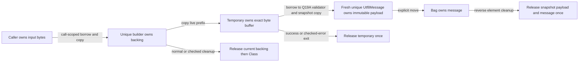

> Historical donor documentation, preserved for design and usage context. Private host paths are omitted; original bytes and qualification receipts remain in the verified donor archive. This is not current foundation qualification.

# ADR 0102: Counted byte assembly and immutable UTF-8 snapshots

Status: **Option A approved, implemented and qualified, 2026-10-16.**
Milestone `ASTRA-TEXT-OWN-1B-UTF8-BUILDER-1`, 2026-10-16.

## Fresh baseline and feasibility

The live repository is `<historical-private-path>`, branch `astra-lazy-1`,
HEAD `c7d2c376dbb5d792aab8da13710b2c3fd2e2188b`, tree
`6948e748929e1aee21e45239b81cb2a03fb8056c`. The initial tracked worktree and
index were clean. The 17 initial untracked files are protected by individual
SHA256/mode/size/uid/gid records. Prior published staging was preserved in full
by rename before installed native intake prepared this submission.

The current tracked compiler was regenerated with Meson's actual Vala command
and rebuilt serially in the verified existing external build tree. Five existing
Q19A/Q11F test registrations pass: 15 TAP contract groups, 366 Q19A execution
commands, 337 Bag execution commands, and 50 source refusals/400 checks. Q19A's
52 and Bag's 30 unsuppressed memory runs are freshly rerun. The two-specialization
diagnostic application passes native/O2, real 2-to-3 growth, early return and
checked-error cleanup. These validate existing facilities, not a new builder.

The new feasibility recipe passes
117 command checks, including 12 unsuppressed Valgrind runs. Six small positive
programs pass all seven dump stages, native execution and independently emitted,
verified, optimized and linked LLVM. Five deliberate source refusals reach their
expected parser or semantic gate. See baseline evidence
for exact commands, identities, diagnostics and limits.

| Question | Observed source/runtime evidence | Conclusion |
| --- | --- | --- |
| A Class uniquely owns growing `u8[]` storage | `field-growth`: allocate 3, copy the old 2 bytes, exchange local/field with `swap`; preserve bytes and free both allocations once | Existing buffer ownership/replacement suffices |
| Borrowing input without retaining it | `borrowed-input`: ordinary `u8[]` method argument, copy, mutate/release caller input, verify independent destination | Existing synchronous noescape input suffices |
| Reallocation versus aliases | Later-argument growth, retained field view and direct `w.replace_then_read(w.storage)` reject; unsafe self-alias witness is never executed | Existing conservative field-loan checks supply relevant refusals |
| Owned checked member result | `owned-member-result`: method calls `utf8_message(this.storage)`, returns its owner, then caller mutates/destroys the buffer Class | Existing heap result and Q19A ABI suffice |
| Snapshot of only a live prefix | An exact-size temporary copied from backing produces the expected one-byte message | Existing allocation/indexing suffice, with an additional allocation/copy |
| Subslice of runtime backing | `slice(w.storage,0,1)` rejects: fixed-array-local sources only | Known missing convenience, avoid by exact-size temporary |
| Nonmutating I32 size rejection | `checked-count`: reach INT32_MAX, reject another increment and a negative increment with unchanged count, without large allocation | Subtract-before-add with bool rejection is expressible |
| Encapsulation | Separate application source writes `w.storage[0]` and sets `w.used=INT32_MAX`; `private owned u8[]` rejects in parser | **Builder A is blocked without a separately approved visibility change** |

Actual source anchors at this base:

- `src/syntax/parser.vala:298` admits native Class members; its field branch
  recognizes owned/readonly but no access modifier. `src/syntax/nodes.vala:75`
  has no field visibility authority.
- `src/semantic/analyzer.vala:992` admits owned Class fields and reserves
  readonly for string snapshots. `:2971` resolves receiver/object field Places
  without a caller visibility check; `:3091` limits `slice` to fixed-array locals.
- `src/semantic/analyzer.vala:2088` handles exact owned field replacement;
  `:2732` checks buffer owner slots for exchange; `:3347` and argument checking
  retain conservative containing-object/field borrow exclusions.
- `src/semantic/semantic-text.vala:22`, `src/core/core-text.vala`, and
  `src/nabi/native-text.vala` retain the canonical Q19A validation, result and
  receiver-text contracts. No alternate validator or byte-to-string cast is needed.
- `src/backend/llvm/llvm-buffer-allocation.vala:38` checks native allocation
  extent and retains fatal hosted OOM; ordinary field/buffer cleanup already
  exists through Core/CFG/SSA/native/LLVM. No realloc primitive is needed.
- `lib/astra/collections/bag.astra` remains the one exact-Class generic bag;
  its slot descriptor is not a byte buffer implementation.

## A: approved builder and separately approved field privacy

The proposal presented these two explicit scopes, now both approved:

1. **A-library:** an opt-in `lib/astra/text/utf8-byte-builder.astra`, with the
   following concrete source API and implementation policy.
2. **A-visibility:** a separate minimal compiler change admitting contextual
   `private` on fields of ordinary nongeneric native Classes, using their
   existing field types. Access is allowed only within a constructor, method,
   accessor or destructor lexically declared on that exact containing Class.
   Other free functions, callers and derived-Class members cannot read, write,
   borrow, index, replace, exchange or name-initialize those fields. Unqualified
   existing fields retain their present accessibility. No private methods,
   protected/friend/module system, generic-Class visibility, new storage shape,
   borrow rule, allocator or public ABI is proposed. Existing identifier uses
   of `private` must remain legal where no modifier is parsed.

Prospective declaration: **`private` is unsupported at the baseline**. The body
will use ordinary current-source operations; this is a contract, not an already
compiled library:

```astra
class Utf8ByteBuilder {
	private owned u8[] backing;
	private int used;
	init() { /* empty backing and used = 0 */ }
	bool reserve(int requested) { /* exact capacity, no shrink */ }
	bool append_bytes(u8[] fragment) { /* copy raw counted bytes */ }
	int byte_count() { return this.used; }
	int capacity() { return len(this.backing); }
	owned Utf8Message snapshot() throws InvalidUtf8 { /* exact prefix -> Q19A */ }
}
```

Invariant: `0 <= used <= len(backing) <= INT32_MAX`; backing has exactly one
buffer cleanup responsibility inside one ordinary unique Class owner. There is
no returned byte slice, writable descriptor or unfinished string view. The
source-visible observations are copied scalar counts and independently owned
messages. No caller can obtain the builder's backing for a self-append; existing
field-loan controls remain enforced for internal helper calls. A class reference
borrow does not transfer its unique cleanup responsibility.

`reserve(n)` returns false for negative n before mutation; otherwise it is a
no-op when capacity suffices. Growth allocates exactly n zeroed bytes, copies
the live prefix, swaps complete owners and lets the temporary retire old backing.
It never changes used. Allocation exhaustion remains fatal without unwind.

`append_bytes(fragment)` first obtains the exact fragment count, then rejects
`fragment_count > INT32_MAX - used` with false and unchanged live state. Only
after that check may it add the counts. Empty append is a successful no-op.
If necessary, capacity grows geometrically from 1 by doubling; before a doubling
would overflow, use the already checked required count. Allocate/copy before
commit, then copy the fragment in order and commit used once. Successful append
never consumes, retains or changes the caller's array. Fragment validity is
irrelevant here; scalar boundaries may straddle calls. No callback or suspension
can observe a partially committed operation. All index checks stay enabled.

`snapshot()` always allocates an exact-used-length temporary and copies the
live prefix, then calls the unchanged `utf8_message(temporary)`. The ordinary
checked owned-result return publishes a new `Utf8Message` only on success.
InvalidUtf8 retires the temporary and ordinary error owner through established
checked cleanup; the builder's contents/count/capacity remain intact. Appending
a missing continuation can then make a subsequent snapshot succeed. Valid
snapshots never alias backing or the temporary, and survive future growth or
builder destruction. Embedded NUL, combining bytes and shortest-form scalar
validation retain Q19A's exact contract.



Costs: no-growth append O(fragment length); growth O(new capacity + live length
+ fragment length), including zero initialization. Automatic doubling amortizes
across appended bytes until the signed-I32 doubling cutoff. Above that cutoff,
the approved exact-required fallback can copy on every small append. Explicit
reserve sequences carry their own full copy/zero costs. Snapshot is O(used): temporary zero/copy, validation, then
the existing message payload zero/copy. Nonempty snapshot adds one temporary
allocation beyond Q19A's message/payload allocations. Approximate live byte
storage at success peak is capacity + 2*used, plus object/allocator overhead.
Empty buffers skip payload allocation under current policy. These are design
costs; implementation must measure actual allocation counts and cleanup.

### Visibility authority and independent verification plan

The modifier must be a declaration-owned visibility/containing-Class identity,
not a privileged builder name or a source-file convention. Parser/Syntax retain
its span and reject unsupported placements. Checked verifies every field access
path, including borrowed/indexed/indirect Places, ownership operations and named
initializers. Check constructor/accessor/destructor contexts explicitly; a static
diagnostic must precede lowering on external access.

Core must retain its own field visibility and lexical declaring-Class authority,
and reject forged private-field accesses independently of Checked. CFG and SSA
must reconstruct/preserve the exact field, caller and access relation, including
implicit lifecycle cleanup. Native correspondence must retain the declaration
and member identity needed to check that authorization, without a runtime access
flag or layout change. LLVM binding checks must still match the authorized
field/class/function and actual address/cleanup operations. Add authentic
mutation/restore tests at affected stages; do not execute corrupted LLVM or
claim privacy from a successful LLVM type verifier alone. Existing Q19A and Bag
contract tests provide independently rerun reuse evidence, not new visibility
proof. If this cannot be implemented in the stated scope, return for a decision.

After approval, qualify the complete supplied acceptance matrix: runtime
fragments, split scalars and retry, counted NUL and malformed encodings, real
2-to-3 reserve, repeated stable snapshots, input retirement, owner moves,
early/checked exits, source alias/privacy refusals, boundary counts without huge
allocation, native/O2 identity observers and unsuppressed Valgrind. The application
must assemble messages in Astra and move them into the existing Bag<Utf8Message>.
Run the supplied focused compatibility selection; full registry/LAZY/CAD/provider
acceptance remains outside this task. A receives PASS only after measured delivery.

## B: independent narrow alternative

Only if the user explicitly chooses B, implement an ordinary opt-in function:

```astra
owned Utf8Message join_utf8_bytes(u8[] first, u8[] second) throws InvalidUtf8;
```

Borrow exactly two fragments, check total before addition/allocation, allocate
an exact temporary, copy in order, and call Q19A. Preserve input and independent
result ownership, malformed handling, split scalars and embedded NUL. There is
no mutable retained builder, reserve or multi-append API and no visibility change.
The precise blocker for A is unenforced backing/count encapsulation; runtime
subslicing is an avoidable cost rather than that safety blocker.

The signature above has no size-rejection result besides InvalidUtf8; using that
error for overflow would change its meaning. Proposed finite B contract: a
subtract-before-add guard uses the existing explicit fatal assertion/trap path
for an unrepresentable combined count, before mutation/allocation. This is
separate from normal checked InvalidUtf8 and fatal OOM, with no fatal unwind
claim. The exact ordinary assertion provider will be verified before use. If
the user wants recoverable count rejection instead, agree on an explicit finite
API before implementation. B is **PARTIAL** against this builder objective.

## C: hold and decision record

C concludes with design/evidence only and compiler semantics unchanged. The
hold report must state that no builder was delivered. While awaiting the actual
decision, preserve the prepared native intake and do not publish a result.

**Decision: A-library and A-visibility, explicitly approved after reviewing this
proposal and the baseline.** The user's actual reply begins:

> I approve **Option A**, including the bounded UTF-8 byte-builder API and the separately scoped, opt-in `private` Class-field semantics proposed in ADR 0102.

The user requires a source-language visibility rule across files, unchanged
unmarked fields, no escaping mutable buffer, checked arithmetic and safe growth,
counted NUL, complete-sequence Q19A validation, independent immutable snapshots,
unchanged builder state on failure, deterministic cleanup and independent
verifier/source/native/O2/memory qualification. The reply explicitly says to
stop and ask before an additional semantic or ABI requirement. Actual approval
and all requirements are preserved externally in
`runtime/native-current/text-own-1b-approval.json`; the approved proposal's SHA256
is `9040d8ab56e68b9d654d626d491d6fec29b0e34b7c8054a93014dc256870c686`.
The user's approval preceded compiler semantic changes. No pre-existing user file or
historical negative fixture edits were authorized. Any necessary change to those
exact paths needs separate approval. No formatting/I/O task or broader Q19/Q20/Q21
closure follows automatically from this approval.

## Delivered qualification

The source-level builder and lexical private-field rule are implemented within
the approved scope. All 55 selected registrations pass, with 235 TAP subtests.
The new suite passes 411 native/O2 command checks, 31 source refusal cases/221
commands, and 58 unsuppressed standard-allocator memory runs. Independent stage
faults cover private access, native inventory, actual builder allocation/cleanup,
and LLVM field addressing, including folded null addresses. The prior independent
native Class-argument rejection remains intact. No historical fixture changed.

See final validation,
[builder usage](../language/utf8-byte-builders.md) and
[field visibility](../language/private-fields.md) for measured evidence, costs,
test-only near-limit controls and remaining boundaries. No new allocator,
borrow/owned-result ABI, runtime generic system or Q19A validator was needed.
